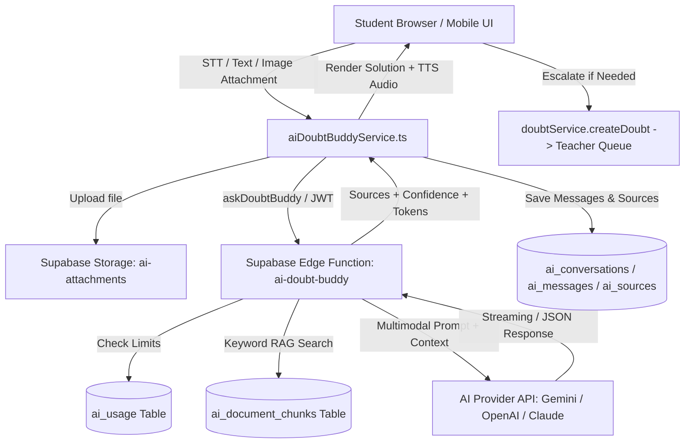

# Phase 5 — SRI SAI AI Doubt Buddy Documentation

## Overview
**SRI SAI AI Doubt Buddy** is a friendly, curriculum-grounded learning companion built into the SRI SAI Tuition & Learning Centre platform. It allows enrolled students to resolve academic queries 24/7 across Mathematics, Physics, Chemistry, Biology, and more, using multimodal input (text, speech-to-text, textbook photo attachments) and step-by-step guidance.

---

## 1. System Architecture



---

## 2. Key Components Created in Phase 5

| Component / File | Purpose |
|---|---|
| `supabase/schema.sql` (Tables 591+) | 6 new tables: `ai_conversations`, `ai_messages`, `ai_attachments`, `ai_sources`, `ai_usage`, `ai_document_chunks` with full RLS and indexes. |
| `supabase/functions/ai-doubt-buddy/index.ts` | Secure server-side Edge Function handling multi-provider switching (Gemini, OpenAI, Claude), rate limiting, safety checks, and RAG context injection. |
| `src/services/aiDoubtBuddyService.ts` | Client service for conversation CRUD, message history, image base64 conversion, Edge Function proxy, and teacher escalation. |
| `src/hooks/useVoiceInput.ts` | Web Speech API integration for Indian-accented speech recognition (`en-IN`) and text-to-speech audio playback. |
| `src/pages/student/StudentDoubtBuddyPage.tsx` | Full-screen interactive AI workspace with conversation sidebar, quick mode chips, image previews, source citations, and TTS. |
| `src/pages/admin/AdminAIUsagePage.tsx` | Admin observability dashboard for daily requests, token counts, error logs, and top queried subjects. |
| `src/config/navigation.ts` | Integrated "✨ Doubt Buddy" into student navigation and "AI & Smart Tools" into admin navigation. |
| `src/routes/AppRoutes.tsx` | Registered `/student/doubt-buddy` and `/admin/ai-usage` routes. |

---

## 3. Supported Modes & Quick Actions

1. **Explain Simply** (`explain_simply`) — Plain language, intuitive analogies, ideal for beginner concepts.
2. **Step-by-Step** (`step_by_step`) — Numbered breakdown showing every mathematical or scientific step clearly.
3. **Give Me a Hint** (`hint`) — Socratic guidance that nudges the student towards solving the problem themselves.
4. **Summarize** (`summarize`) — Key takeaways and high-yield revision bullet points.
5. **Give an Example** (`example`) — Real-world example or solved numerical problem.
6. **Quiz Me** (`quiz_me`) — Generates 3 diagnostic questions to test student comprehension.

---

## 4. Multi-Provider Setup & Edge Function Secrets

All AI credentials are kept **strictly server-side** in Supabase Edge Function Secrets. No private API keys are ever bundled in Vite frontend builds.

### Initial Provider: Groq (Recommended for Ultra-Fast Inference)
The SRI SAI Doubt Buddy is configured out of the box with **Groq** for instantaneous AI tutoring responses:
- **Text & Reasoning Model**: `openai/gpt-oss-120b` (Production reasoning model on Groq, chain-of-thought, math & science)
- **Vision Model (Textbook Photos & Diagrams)**: `qwen/qwen3.8-27b` (Production multimodal vision model on Groq, 131k context, OCR/diagrams)

### Step 1: Set Edge Function Secrets
In your Supabase Dashboard under **Project Settings > Edge Functions > Secrets** (or via `supabase secrets set` CLI):

```bash
# Initial Provider: Groq (ultra-fast GPT-OSS 120B & Qwen 3.8 27B Vision)
AI_PROVIDER=groq
GROQ_API_KEY=gsk_your_groq_api_key_here
GROQ_TEXT_MODEL=openai/gpt-oss-120b
GROQ_VISION_MODEL=qwen/qwen3.8-27b

# Optional alternative providers (seamlessly hot-swappable):
# AI_PROVIDER=gemini
# AI_MODEL=gemini-1.5-flash
# AI_API_KEY=AIzaSy...your_gemini_key

# Alternatively for OpenAI:
# AI_PROVIDER=openai
# AI_MODEL=gpt-4o
# AI_API_KEY=sk-...

# Alternatively for Anthropic Claude:
# AI_PROVIDER=claude
# AI_MODEL=claude-3-5-sonnet-20241022
# AI_API_KEY=sk-ant-...

# Daily student quotas:
MAX_DAILY_AI_REQUESTS=50
MAX_IMAGE_REQUESTS=10
```

### Step 2: Deploy the Edge Function
```bash
supabase functions deploy ai-doubt-buddy --no-verify-jwt
```

---

## 5. RAG (Retrieval-Augmented Generation) Knowledge Base

To make AI responses quote official SRI SAI study material:
1. Extract text/topics from study material PDFs.
2. Insert chunks into `ai_document_chunks` table:
   ```sql
   INSERT INTO ai_document_chunks (subject, grade, title, chunk_text, page_number)
   VALUES (
     'Mathematics',
     'Class 10',
     'Quadratic Equations Chapter 4 Notes',
     'Standard form of quadratic equation is ax^2 + bx + c = 0. Quadratic formula is x = (-b ± √(b^2 - 4ac)) / (2a). Discriminant D = b^2 - 4ac.',
     12
   );
   ```
3. When a student asks a question, relevant chunks are automatically retrieved and injected into the AI system prompt. The student sees a green `📚 Based on SRI SAI Study Material` badge.

---

## 6. Voice & Vision Capabilities

- **Voice Input (STT)**: Uses Web Speech API configured with `en-IN` (Indian English) language model for seamless transcription of Telugu/Hindi accent English. Live interim transcripts are displayed in real-time.
- **Text-to-Speech (TTS)**: Built-in voice player strips markdown tags and uses Indian English voices (`en-IN`) with play/pause controls on every AI message.
- **Vision (Photo Attachments)**: Students can snap/upload textbook questions or handwritten notes (JPEG, PNG, WebP up to 10MB). Images are sent to multimodal LLMs (Gemini / GPT-4o / Claude 3.5 Sonnet) as inline Base64 attachments.

---

## 7. Safety, Guardrails & Human Escalation

- **Non-Academic Filter**: Refuses non-educational questions and prompts the student to ask curriculum-related topics.
- **Quota Safeguards**: 50 questions/day and 10 images/day per student stored in `ai_usage` table.
- **Teacher Escalation ("Ask My Teacher")**: If the AI explanation is insufficient, one click sends the doubt directly to the faculty doubt clinic with the conversation context automatically attached.
